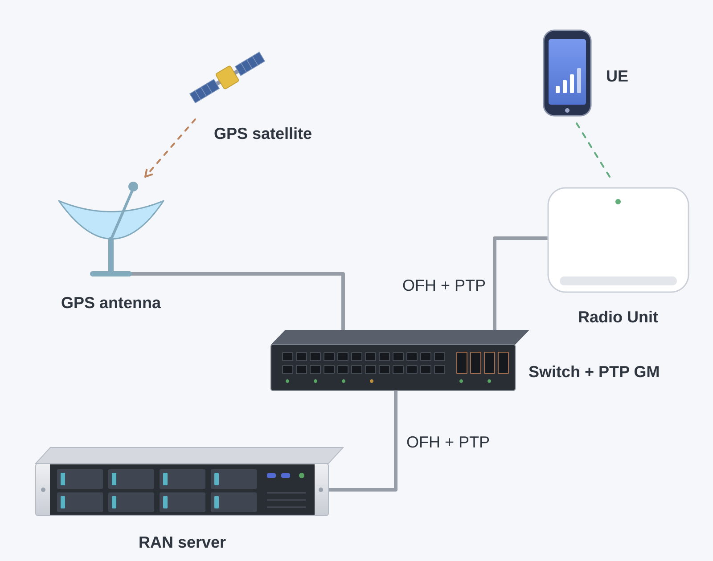
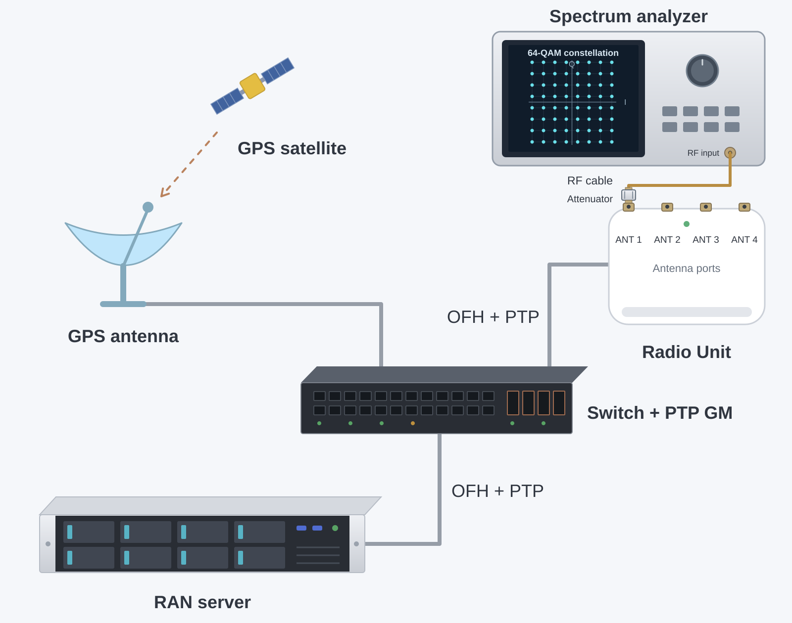

import Tabs from '@theme/Tabs';
import TabItem from '@theme/TabItem';

# Onboarding a new O-RAN radio unit

## Overview

The other pages in this section describe radio units that have already been integrated with OCUDU. This page is for the step before that: you have an O-RAN split 7.2 radio unit (O-RU) that nobody has run with OCUDU yet, and you want to get it working and added to the [list of radio units](index.md#radio-units).

It applies whether you are an RU vendor qualifying your own product, an operator or lab evaluating a unit, or a community member with an RU on the bench. It is vendor-neutral: it describes what to check and in which order, not how to configure a specific device.

OCUDU's Open Fronthaul (OFH) library implements the O-RAN WG4 specifications without vendor-specific code paths. A new RU is therefore an interop exercise, not a porting effort. In most cases the work is matching configuration on both sides. Where the RU and OCUDU read the specification differently, the fix is a configuration option, an RU firmware change, or an OCUDU change, in that order of preference. See [When the RU does not interoperate](#when-the-ru-does-not-interoperate).

If this is your first O-RAN RU of any kind, start with the [Connecting an O-RAN 7.2 radio unit](../../tutorials/oranru/index.md) tutorial. It covers the NIC, switch, PTP and DPDK setup that this guide assumes.

## The integration path

An integration moves through a series of milestones. Each one maps onto a support status in the [RU tables](index.md#support-status), so you can report the RU as soon as you reach the first one and update the entry as you get further.

| Step | Milestone | Status you can report |
| --- | --- | --- |
| 1. [Prepare](#1-prepare) | RU details collected, lab set up, DU and RU synchronized | |
| 2. [CU-plane](#2-cu-plane) | COTS UE attaches and passes DL and UL traffic | CUS 🟡 |
| 3. [Features](#3-features) | Bandwidths, MIMO configurations, compression and other features tested, full rate reached, configuration public | CUS 🟢 |
| 4. [RF](#4-rf) | SSB block power computed or measured | RF 🟡 or 🟢 |
| 5. [M-plane](#5-m-plane) | RU configured and monitored over NETCONF | M 🟡 or 🟢 |
| 6. [Contribute](#6-contribute-the-result) | Table row and guide merged | Listed |

Steps 1 to 3 have to be done in order, since each one depends on the previous. In particular, the integration itself only starts once the DU and RU are synchronized at the end of step 1. The RF step is an extra on top of a working integration and is scored in its own column. The M-plane is independent and is usually done last; many lab integrations never get to it, and a CUS-only integration is a complete result
as long as there is a way to configure the RU via a config file, command line or web interface.

You do not have to finish the full path before contributing. Even if the RU does not reach 🟡 yet, a table row with a note on what works and what is missing is useful to the next person who picks up the same RU.

## 1. Prepare

This step covers everything that has to be in place before the actual integration starts: the RU details, the lab, and a working S-plane. The later steps assume that the DU and RU are synchronized; if they are not, every CU-plane problem looks like a timing problem.

### Collect the RU details

Get the following from the RU vendor or the RU documentation before setting anything up. Most failed integrations come from one of these values being wrong or missing, and most of them also end up in the final report.

| Item | Why it matters |
| --- | --- |
| RU model and firmware version, with release notes | Timing parameters and supported features change between firmware versions. The firmware version goes into the table. |
| Supported bands, bandwidths, numerology and TDD patterns | Many RUs only accept a subset of TDD patterns. |
| eAxC ID layout (DU port, band sector, CC, RU port bit widths) | Must match `dl_port_id`, `ul_port_id` and `prach_port_id`. |
| Delay profile: `T2a_min/max`, `Ta3_min/max` or the equivalent `T1a`/`Ta4` windows | Needed to derive the OCUDU transmit and receive windows. |
| Supported compression methods and bit widths, static or dynamic compression header | Must match `compr_method_*`, `compr_bitwidth_*` and `enable_*_static_compr_hdr`. |
| PRACH handling: C-plane type 3 support, FFT size, start-symbol behaviour | Most early PRACH failures come from here. |
| Maximum output power per port, the IQ reference level and the IQ full-scale convention (16-bit or O-RAN FS_Offset) | Needed for the [IQ sample scaling](#iq-sample-scaling) and RF calibration. |
| S-plane configuration: LLS-C1/C2/C3, PTP profile, domain number, transport | Must match the grandmaster and switch. |
| M-plane support: NETCONF version, YANG models, call-home or static IP | Decides whether the RU needs a config file or an M-plane client to start at all. Some RUs can only be configured over the M-plane. |

### Check the list first

Search the [RU tables](index.md#radio-units) and the [community discussions](https://gitlab.com/ocudu/community/discussions) for the same RU or a close relative from the same vendor. An RU that shares a platform with a listed one often takes the same timing windows and PRACH settings, and the existing guide is a better starting point than the defaults. The [Metanoia reference design](https://metanoia-comm.com/products/5g/cobra/) for example is a popular base for
new vendors. So far all tested models have worked out of the box without much tweeking.

### Set up the lab

The lab setup allows two testing configurations: over-the-air (OTA) testing with a commercial off-the-shelf (COTS) UE, and conducted testing with a spectrum analyzer.
The OTA setup is usually sufficant to get a "working" config and allows verification of downlink and uplink traffic.
The conducted setup is prefered for RF troubleshooting and for proper downlink power calibration.
Both configurations use the same RAN server, switch, and GPS-based synchronization setup.

<Tabs>
  <TabItem value="ota" label="Over-the-air setup" default>

  </TabItem>
  <TabItem value="conduted" label="Conducted setup">


A conducted setup, with the RU connected to the UE and/or measurement equipment through cables and attenuators, makes every later step easier to debug and is required for an RF 🟢 result.

:::warning
Never connect RU TX ports directly to a UE or measurement equipment without enough attenuation. Check the maximum input power of every device in the chain.
E.g. for an anylyzer supporting up to 0dBm input power and an indoor RU with +24dBm output power 30dB attenuators are fine.
:::
  </TabItem>
</Tabs>


### Synchronize the DU and RU (S-plane)

The S-plane provides frequency and phase synchronization between the DU and the RU. OCUDU does not implement PTP itself; the host is synchronized using a third-party stack such as [linuxptp](https://linuxptp.sourceforge.net//). See [Switches and timing](../switches_and_timing/index.md) for devices that have been used as grandmaster or boundary clock.

#### Synchronization topology

We recommend onboarding a new RU in LLS-C3 mode in which common PTP grandmaster provides sync to both the DU and RU, both acting as slaves.
Confirm the PTP profile (typically ITU-T G.8275.1, L2 multicast) and the domain number match on the grandmaster, switch, DU and RU.

#### Verify the DU clock

1. Start `ptp4l` on the fronthaul NIC and `phc2sys` to steer the system clock. [This](../../tutorials/oranru/index.md) tutorial provides a sample.
2. Confirm `ptp4l` reports the port in `SLAVE` state and the master offset stays within **±25 ns**.
3. Confirm `phc2sys` reports an offset within **±25 ns**.

#### Verify the RU clock

1. Check the RU's own sync status (vendor CLI, web interface, or the `o-ran-sync` YANG model over the M-plane).
2. The RU should report a locked state, for example `LOCKED` in `o-ran-sync:sync/sync-status`.
3. Record the time it takes the RU to lock after boot. Some RUs will not start transmitting until locked.

:::info
Some RUs also require SyncE to be enabled and active in the network before locking PTP.
:::

### Keep a record as you go

The final contribution is much easier to write if you collect these from the start:

- The OCUDU version or commit and the RU firmware version for every test.
- The DU YAML and the RU configuration (file, CLI dump or M-plane configuration) for every configuration that worked.
- DU console output and logs, including the [OFH metrics](../../user_manual/outputs/outputs.md#ofh-metrics), for each milestone.
- What did not work, and what you changed to get past it.

### Ready to start when

- [ ] The RU details above are known, or marked as unknown.
- [ ] The lab is set up and the configuration and logs of each test are being recorded.
- [ ] DU and RU are both locked to the same grandmaster.
- [ ] Offsets are stable over e.g. one hour.
- [ ] There are no holdover or free-run events. Keep checking this during the following steps.

## 2. CU-plane

The C-plane and U-plane are implemented in the OFH library and configured through the `ru_ofh` section of the DU configuration. See the [configuration reference](../../user_manual/config_reference/config_reference.mdx) for all parameters.

Start from the sample configuration of the closest listed RU, or from the tutorial if there is none, and change one thing at a time.

### IQ sample scaling

The RU maps the power of the IQ samples it receives, in dBFS, to RF output power. For the output power to be right, OCUDU and the RU have to agree on two things:

- **The full scale**, i.e., which IQ value is 0 dBFS.
- **The reference level**, i.e., which IQ power the RU maps to its maximum output power, and whether the bandwidth is normalized by OCUDU or by the RU.

RU implementations follow one of two full-scale conventions. Ask the RU vendor which one the RU uses before setting any power related parameter. With BFP9, the two differ by about 48 dB, so a mismatch either leaves the cell barely visible or drives the RU into saturation.

:::danger
Set up the IQ sample scaling before the first transmission, and in particular before running _testmode_, which transmits a fully loaded carrier on every symbol. If OCUDU uses the O-RAN full scale while the RU expects the 16-bit one, the BFP exponents overflow the RU's 16-bit samples and the RU can transmit a distorted signal at up to its full output power, which can saturate the power amplifier and damage the RU or the equipment connected to it. The opposite mismatch is harmless, as the signal is only about 48 dB too weak. If in doubt, leave `fs_offset_dl` unset, start with a reference level below the default, for example −20 dBFS, use the conducted setup with enough attenuation, and raise the level in steps while watching the output power.
:::

| | FlexRAN-style (16-bit) | O-RAN compliant |
| --- | --- | --- |
| Full scale | 16-bit full scale of I or Q, independent of the compression. The RU decompresses BFP into 16-bit samples. | 24-bit full scale with an default FS_offset=0 for bfp9. |
| FS_Offset equivalent | 2 · (m − 1) for an m-bit BFP mantissa, e.g., 16 for BFP9. 0 without compression. | Configured in the RU, 0 by default. One step is 3.01 dB. |
| Typical RUs | RUs developed against Intel FlexRAN-based DUs. | RUs that implement the O-RAN power definitions, often with M-plane support. |
| OCUDU setting | `fs_offset_dl` and `fs_offset_ul` not set (default). | `fs_offset_dl` and `fs_offset_ul` set to the FS_Offset of the RU. |

Without compression, both conventions use the full scale of the IQ bit width, so they only differ for BFP.

:::note
Not setting `fs_offset_dl` is not the same as setting it to 0. Unset keeps the OCUDU native 16-bit full scale. A value of 0 selects the O-RAN default full scale, which for BFP9 is 48 dB above it.
:::

Configure the scaling for the convention the RU uses:

<Tabs>
  <TabItem value="flexran" label="FlexRAN-style RU" default>

The RU expects the IQ data relative to the 16-bit full scale. This is the OCUDU default, so the FS_Offset parameters stay unset:

```yaml
ru_ofh:
  compr_method_dl: bfp
  compr_bitwidth_dl: 9
  compr_method_ul: bfp
  compr_bitwidth_ul: 9
  # fs_offset_dl and fs_offset_ul not set: 16-bit full scale (FS_Offset 16 for BFP9)
  ru_reference_level_dBFS: -12
  subcarrier_rms_backoff_dB: auto
```

Some of these RUs document their expected input level as a 16-bit IQ level or a DL scaling value. Use it as the starting point for `ru_reference_level_dBFS`, and see the existing RU guides for examples.

**Bandwidth normalization.** O-RAN places the bandwidth normalization in the DU: the power summed over all subcarriers must not exceed the reference level (clause 8.1.3.3). OCUDU does this with `subcarrier_rms_backoff_dB: auto`, which spreads the reference level over all 12 · N_RB subcarriers, so the output power stays the same for every bandwidth.

Some FlexRAN-style RUs normalize the gain to the configured bandwidth themselves, which is not O-RAN compliant. Normalizing in both places changes the output power with the bandwidth. For these RUs, set a fixed back-off as given in the RU documentation, and calibrate it per bandwidth in the [RF calibration](#rf-calibration):

```yaml
ru_ofh:
  ru_reference_level_dBFS: -12
  subcarrier_rms_backoff_dB: <value>  # From the RU documentation, the same for all bandwidths
```

  </TabItem>
  <TabItem value="oran" label="O-RAN compliant RU">

The RU interprets the IQ data relative to the O-RAN full scale and its configured FS_Offset. Set both FS_Offset parameters to the values configured in the RU, which are 0 unless the RU configuration or the M-plane says otherwise:

```yaml
ru_ofh:
  compr_method_dl: bfp
  compr_bitwidth_dl: 9
  compr_method_ul: bfp
  compr_bitwidth_ul: 9
  fs_offset_dl: 0                  # FS_Offset of the RU TX endpoints
  fs_offset_ul: 0                  # FS_Offset of the RU RX endpoints, also used for PRACH
  ru_reference_level_dBFS: -12     # Raise towards the RU Reference_Level, 0 dBFS by default
  subcarrier_rms_backoff_dB: auto
```

With the scales aligned, `ru_reference_level_dBFS` corresponds to the O-RAN Reference_Level: the IQ power that the RU maps to its maximum output power, according to the DL gain configured in the RU (clause 8.1.3.2.2). If the RU does not configure a Reference_Level, it is 0 dBFS. Start below it, for example with the default of −12 dBFS, and raise it while watching the output power and the RU's DPD status.
  </TabItem>
</Tabs>

### Transport

Match these on both sides before starting the DU:

- `ru_mac_addr` and `du_mac_addr`.
- `vlan_tag_cp` and `vlan_tag_up`, and optionally `vlan_pcp_cp` and `vlan_pcp_up`.
- `mtu`: jumbo frames (9000) are needed for wide bandwidths with multiple antennas. Check the NIC and every switch port on the path.
- eAxC IDs: `dl_port_id`, `ul_port_id` and `prach_port_id`.

### Timing windows

For the front haul to work we need to set and calibrate eight timing window parameter. Have a look at ORAN WG4
for a detailed explanation. All values are in microseconds before (for `t1a_*`) or after (for `ta4_*`) the over-the-air time of the symbol.

| OCUDU parameter | Meaning |
| --- | --- |
| `t1a_min_cp_dl`, `t1a_max_cp_dl` | DL C-plane transmit window at the DU | 
| `t1a_min_cp_ul`, `t1a_max_cp_ul` | UL C-plane transmit window at the DU |
| `t1a_min_up`, `t1a_max_up` | DL U-plane transmit window at the DU |
| `ta4_min`, `ta4_max` | UL U-plane receive window at the DU |

If you are unsure what your RU expects, start from a working configuration of another RU, for example the [Pegatron guide](pegatron.md#configuration), and calibrate from there.

### OFH window calibration procedure

The DL windows (`t1a_*`) can only be calibrated by watching the RU: it is the RU that sees whether a DL message arrived early or late. The UL window (`ta4_*`) can only be calibrated by watching the DU. Calibrate the RU side first, then the DU side.

Before you start:

- Confirm the [S-plane](#synchronize-the-du-and-ru-s-plane) is locked on both the DU and the RU. Timing calibration on an unsynchronized setup gives meaningless results.
- Find where the RU reports its reception counters, for example `RX_ON_TIME`, `RX_EARLY` and `RX_LATE` for the U-plane and `RX_ON_TIME_C`, `RX_EARLY_C` and `RX_LATE_C` for the C-plane on a Benetel RU. See [RU late or early packets](../../user_manual/troubleshooting/troubleshooting.md#ru-late-or-early-packets) for an example.
- Restart the DU after every change and let it run for several reporting periods before reading the counters. One or two intermittent early or late packets are normal; a sustained count is not.
- For this calibration it is very handy to use the built-in testmode do stimulate the RU and generate constant downlink and uplink OFH traffic. Check the [testmode tutorial](../../tutorials/testmode/index.md). Only do this after setting up the [IQ sample scaling](#iq-sample-scaling).

Calibrate the windows in this order, one at a time:

1. DL C-plane: `t1a_min_cp_dl`, `t1a_max_cp_dl`.
2. UL C-plane: `t1a_min_cp_ul`, `t1a_max_cp_ul`.
3. DL U-plane: `t1a_min_up`, `t1a_max_up`.
4. UL U-plane at the DU: `ta4_min`, `ta4_max`.

#### Steps 1 to 3: DL windows at the RU

For each `t1a_min`/`t1a_max` pair:

1. **Start low.** Set a small window close to the over-the-air time, for example `t1a_max: 140` and `t1a_min: 100`. A 40 µs window is a little more than one OFDM symbol at 30 kHz SCS (35.71 µs).
2. **Confirm late packets.** The RU should now report late packets for this message type. If it does not, reduce both values further until it does.
3. **Find `t1a_min`.** Increase `t1a_min` and `t1a_max` together, in steps of about 40 µs, until the late packets disappear from the RU counters. Keep this `t1a_min` from now on.
4. **Find `t1a_max`.** Increase only `t1a_max`, in the same steps, until the RU starts reporting early packets. Then go back one step, to the last `t1a_max` without early packets.

Then move on to the next pair. With the C-plane done first, any remaining early or late packets in the U-plane counters can be attributed to the U-plane windows.

#### Step 4: UL window at the DU

1. Run UL traffic, or at least let the RU send UL U-plane data for every UL symbol. If you're using _testmode_ this is the case by default.
2. Check the DU [OFH metrics](../../user_manual/outputs/outputs.md#ofh-metrics) for the cell. `received_packets.late` and `rx_window_stats.nof_missed_uplink_symbols` should stay at zero.
3. If late packets remain, increase `ta4_max`.

#### Quick troubleshooting

| Symptom | Action |
| --- | --- |
| Early packets at the RU | `t1a_max` is too high; reduce it. |
| Late packets at the RU | `t1a_max` is too low; increase it. |
| Late packets at the DU | Increase `ta4_max`. |
| Early and late packets at the RU at the same time | The DU and the RU are not synchronized to the same clock. Check PTP on both sides before changing any window. |

### Downlink

Once the timing has been calibrated we can continue by looking at the DL signal.

* If you're runnning with _testmode_ and have a spectrum analyzer you should see a fully allocated DL signal.
* If you're not running with _testmode_ you'll only see the SSB transmission approxmately every 20ms as well as a wide band sparse signal which is the cell specific reference signal (CSI-RS).

A UE scanner should now also see the cell at the expected frequency with the configured PCI. If the signal is far weaker than expected, for example by about 48 dB with BFP9, or the RU reports saturation, check the [IQ sample scaling](#iq-sample-scaling).
Once the RU reports no sustained early or late packets and the cell is visible at the expected frequency and PCI, move on to the uplink.

### Uplink

Since the OFH window has already been calibrate we also assume perfect timing for the UL.

1. **PRACH.** Trigger a UE attach and confirm PRACH detection in the DU log (enable `log --phy.level=info`). Check the `rx_window_stats.nof_missed_prach_occasions` in the [OFH metrics](../../user_manual/outputs/outputs.md#ofh-metrics). The counter should be zero.
2. **Attach and traffic.** Attach a COTS UE, then run DL and UL iperf in SISO, then with two and four DL MIMO layers if the RU supports them. See [UE attach failure](../../user_manual/troubleshooting/troubleshooting.md#ue-attach-failure) if the UE sees the cell but does not attach.

### Done when

- [ ] No sustained early or late packets on either side, at the RU and in the DU OFH metrics.
- [ ] A COTS UE attaches and detaches reliably, repeated for at least 10 times.
- [ ] DL and UL traffic flows.

At this point the RU can be reported as CUS 🟡. Note any restriction, such as an unsupported TDD pattern or a rate below the expected peak, in the report.

## 3. Features

This step turns a working integration into a characterised one, and it is what makes the guide useful to someone choosing an RU. It takes the RU from CUS 🟡 to 🟢.

### Configurations to cover

Cover the configurations the RU supports, such as the different bandwidths, MIMO configurations and compression settings, and record the result for each:

| Feature | Parameters | Tested values |
| --- | --- | --- |
| Duplex and TDD pattern | `cell_cfg.tdd_ul_dl_cfg` | DDDDDDDSUU and DDDSU |
| Bandwidth | `cell_cfg.channel_bandwidth_MHz` | 20, 40, 80 and 100 MHz for TDD, 10 and 20 MHz for FDD|
| Numerology | `cell_cfg.common_scs` | 15kHz for FDD, 30kHz for TDD |
| Compression | `compr_method_*`, `compr_bitwidth_*` | uncompressed (none), bfp9, bfp14 |
| Static compression header | `enable_ul_static_compr_hdr`, `enable_dl_static_compr_hdr` | true or false |
| PRACH format | `cell_cfg.prach.prach_config_index` | short (e.g. 159) or long PRACH (e.g. 16) configs |
| MIMO layers / antenna ports | `cell_cfg.nof_antennas_dl`, `cell_cfg.nof_antennas_ul` | 1, 2, 4 or 8 antennas |
| Multiple cells or carriers | `cells` list | One or more component carrier (CC) |

### Throughput

Record the achieved throughput against the theoretical peak for the configuration:

| Configuration | DL expected | DL measured | UL expected | UL measured |
| --- | --- | --- | --- | --- |
| FDD 20 MHz, 2T2R | | | | |
| TDD 100 MHz, 4T4R, DDDSU | | | | |

Optionally, do over-the-air tests and long-duration stability runs.

### Done when

- [ ] The configurations above are tested and full DL and UL rate is reached for each of them.
- [ ] The working configuration is public, either as an [RU guide](#6-contribute-the-result) on this site or as a reference configuration in a public OCUDU issue or work item.

At this point the RU can be reported as CUS 🟢.

## 4. RF

The RF step is an extra on top of a working integration. It does not change the CUS status; it is scored in its own RF column.

It builds on the [IQ sample scaling](#iq-sample-scaling) set up in the CU-plane step.

### RF calibration

`cell_cfg.ssb.ssb_block_power_dbm` tells the UE the transmitted energy per resource element (EPRE) of the SSB. The UE uses it to estimate the path loss, which drives uplink power control and PRACH power ramping. If it is wrong, the uplink of every UE is off by the same amount. The RF status records how well this value is known.

#### Approximate the SSB block power (RF 🟡)

1. Get the RU's maximum rated output power per port from the datasheet, and configure the RU for it.
2. Use a reference configuration, for example the RU's main bandwidth and MIMO configuration, with `ru_reference_level_dBFS` set so that a fully loaded carrier reaches the rated power without DPD saturation. See [RU power and DPD saturation](../../user_manual/troubleshooting/troubleshooting.md#ru-power-and-dpd-saturation).
3. With the default `subcarrier_rms_backoff_dB: auto`, the power is spread evenly over all subcarriers of the carrier, so the SSB EPRE is approximately:

   `ssb_block_power_dbm ≈ P_max_port − 10·log10(N_RB × 12)`

   For example, a 100 MHz carrier at 30 kHz SCS has 273 PRBs, or 3276 subcarriers, which is 35.2 dB. An RU with 24 dBm per port then gives about −11 dBm, and one with 37 dBm about 2 dBm.
   There is an online tool [here](https://5g-tools.com/5g-nr-ssb-sss-epre-power-calculator/) that can be used to calculate the value. 
4. Set `ssb_block_power_dbm` to this value and record the reference configuration it was computed for.

#### Measure and calibrate (RF 🟢)

This needs the conducted setup and RF measurement equipment.

1. For each bandwidth and MIMO configuration you report, measure the channel power per port with a spectrum analyzer and record the offset from the rated power.
2. Measure the SSB EPRE directly (sometimes called SS-RSRP) and set `ssb_block_power_dbm` to the measured value.
3. Record the calibrated `ru_reference_level_dBFS` and `ssb_block_power_dbm` for each configuration in the guide.

### Transmitter quality

The following transmitter measurements are optional and do not affect the RF status. 
If you have the equipment, adding some of them to the guide makes it more useful to someone choosing an RU.
For example, measured per port at full load with the modulation used in the throughput tests:
- Channel power, compared with the rated output power.
- EVM at 256QAM, with a 3GPP TS 38.104 limit of 3.5%.

:::info
A full RF characterization of the RU, especially for the receiver, for example conformance testing against 3GPP TS 38.141,
is out of scope of this guide and remains the responsibility of the RU vendor.
:::

### Done when

- [ ] Output power known and `ssb_block_power_dbm` computed for the reference configuration. Report RF 🟡.
- [ ] `ssb_block_power_dbm` measured and calibrated with RF measurement equipment for different bandwidths and MIMO configurations. Report RF 🟢.

## 5. M-plane

The M-plane is the NETCONF/YANG management interface defined in O-RAN WG4. OCUDU uses the M-plane client in the [O1 adapter](https://gitlab.com/ocudu/ocudu_elements/ocudu_oran_apps/ocudu_o1_adapter) to configure the RU and to collect its alarms and measurements. This step checks the client against the RU, covering configuration management (CM), fault management (FM) and performance management (PM) for the `sudo` and `hybrid-odu` roles of O-RAN.WG4.MP.0 Table 6.5-1. If you skip the M-plane and configure the RU statically, record the M-plane status as untested.

If the RU can only be configured over the M-plane, the start-up and CM parts of this step have to be done before step 2, after the S-plane is up.

For the adapter options and the provision profile, see [O-RU M-plane service](https://gitlab.com/ocudu/ocudu_elements/ocudu_oran_apps/ocudu_o1_adapter/-/blob/main/docs/mplane-service.md). For `ru_controller.py`, see [O-RU M-plane client](https://gitlab.com/ocudu/ocudu_elements/ocudu_oran_apps/ocudu_o1_adapter/-/blob/main/docs/mplane-client.md). For testing without hardware, see [M-plane sim loop](https://gitlab.com/ocudu/ocudu_elements/ocudu_oran_apps/ocudu_o1_adapter/-/blob/main/docs/mplane-sim-testing.md).

### Start-up

1. **Reset.** Reset the RU so that no configuration from an earlier run remains, and connect it to a PTP grandmaster it can lock to.
2. **Transport.** Confirm how the RU gets its M-plane IP address (DHCP, static).
3. **Call home.** Check whether the RU accepts NETCONF connections from an O-RU controller or only performs NETCONF call home. For call home, the RU discovers the adapter host as an O-RU controller through DHCP (option 43 for DHCPv4, option 17 for DHCPv6) or from `configured-client-info` in `o-ran-mplane-int`.
4. **Install the adapter.**

   ```bash
   git clone https://gitlab.com/ocudu/ocudu_elements/ocudu_oran_apps/ocudu_o1_adapter.git
   cd ocudu_o1_adapter
   python3 -m venv .venv
   .venv/bin/pip install -r requirements.txt
   ```

### Provision profile

The provision profile describes the RU configuration that the adapter writes over the M-plane. Example for a 4T4R TDD RU at 100 MHz:

```yaml
# provision.yaml
interface:
  ru_mac_addr: "AA:BB:CC:DD:EE:01"
  vlan: 3
  l2_mtu: 1500   # default 9600

processing:
  ru_mac_addr: "AA:BB:CC:DD:EE:01"
  du_mac_addr: "AA:BB:CC:DD:EE:02"
  vlan: 3

endpoint:
  iq_bitwidth: 9
  compression_type: STATIC
  num_prb: 273
  frame_structure: 193
  tx_endpoints:
    - {name: <tx-endpoint-0>, eaxc_id: 0}
    - {name: <tx-endpoint-1>, eaxc_id: 1}
    - {name: <tx-endpoint-2>, eaxc_id: 2}
    - {name: <tx-endpoint-3>, eaxc_id: 3}
  rx_endpoints:
    - {name: <rx-endpoint-0>, eaxc_id: 0}
    - {name: <rx-endpoint-1>, eaxc_id: 1}
    - {name: <rx-endpoint-2>, eaxc_id: 2}
    - {name: <rx-endpoint-3>, eaxc_id: 3}
  prach_endpoints:
    - {name: <prach-endpoint-0>, eaxc_id: 4}
    - {name: <prach-endpoint-1>, eaxc_id: 5}
    - {name: <prach-endpoint-2>, eaxc_id: 6}
    - {name: <prach-endpoint-3>, eaxc_id: 7}

carrier:
  dl_arfcn: 650000
  dl_freq: 3750000000
  ul_arfcn: 650000
  ul_freq: 3750000000
  tx_gain: 20.0
  rf_bandwidth_hz: 100000000

tdd:
  pattern_upload: true

activation: {state: ACTIVE}

pm:
  rx_window_objects: [RX_ON_TIME, RX_EARLY, RX_LATE, RX_CORRUPT, RX_DUPL, RX_TOTAL]
  rx_window_interval: 60
  notification_interval: 60
```

The adapter configures the RU only. Keep the gNB configuration consistent with the profile, or the carriers reach READY but no UE attaches. The table lists the corresponding keys.

| Profile | Corresponding gNB configuration |
|---|---|
| `processing.ru_mac_addr` | `ru_ofh.cells.ru_mac_addr` |
| `processing.du_mac_addr` | `ru_ofh.cells.du_mac_addr` |
| `processing.vlan` | `ru_ofh.cells.vlan_tag_cp`, `ru_ofh.cells.vlan_tag_up` |
| `interface.l2_mtu` | `ru_ofh.cells.mtu` |
| `eaxc_id` in `endpoint.tx_endpoints` | `ru_ofh.cells.dl_port_id` |
| `eaxc_id` in `endpoint.rx_endpoints` | `ru_ofh.cells.ul_port_id` |
| `eaxc_id` in `endpoint.prach_endpoints` | `ru_ofh.cells.prach_port_id` |
| Number of TX and RX endpoints | `cell_cfg.nof_antennas_dl`, `cell_cfg.nof_antennas_ul` |
| `endpoint.compression_type: STATIC` | `ru_ofh.enable_dl_static_compr_hdr: true`, `ru_ofh.enable_ul_static_compr_hdr: true` |
| `endpoint.iq_bitwidth` | `ru_ofh.compr_bitwidth_dl`, `ru_ofh.compr_bitwidth_ul`, `ru_ofh.compr_bitwidth_prach` |
| `endpoint.num_prb`, `endpoint.frame_structure` | `cell_cfg.channel_bandwidth_MHz`, `cell_cfg.common_scs` |
| `carrier.dl_arfcn`, `carrier.ul_arfcn` | `cell_cfg.dl_arfcn`, `cell_cfg.band` |
| `carrier.rf_bandwidth_hz` | `cell_cfg.channel_bandwidth_MHz` |
| `tdd.switching_points` | `cell_cfg.tdd_ul_dl_cfg` |

### Start the adapter

```bash
.venv/bin/python src/o1_adapter.py \
  --profile ru \
  --ru_supervise --ru_callhome \
  --ru_provision_config provision.yaml --ru_pm \
  --ru_netconf_username <sudo-user> --ru_netconf_password <sudo-password> \
  --rpc_log rpc.log --loglevel DEBUG
```

For an RU that accepts NETCONF connections, use `--ru_netconf_host <ru-ip>` instead of `--ru_callhome`.

When the RU connects, you will see the following output:

```text
RU M-plane session: DISCONNECTED -> CONNECTING
Listening for RU call-home on 0.0.0.0:4334
RU call-home connection from <ru-ip>:<port>
RU M-plane session: CONNECTING -> SUPERVISED
```

Record the list of YANG modules and revisions the RU reports in its capabilities. Check `o-ran-module-cap` and `o-ran-compression-factors` against the CU-plane configuration.

### Configuration management (CM)

1. Wait for provisioning. Every carrier reaches READY.
2. Start the gNB and attach a UE, as described in [Initializing the network](../../tutorials/oranru/index.md#initializing-the-network) and [Connecting to the network](../../tutorials/oranru/index.md#connecting-to-the-network). The UE passes traffic in both directions.
3. Reset the RU. The adapter provisions it again and every carrier returns to READY.

When provisioning completes, you will see the following output:

```text
O-RU provisioned; carrier activation receipt: Rx-Array-Carrier-00=READY, ..., Tx-Array-Carrier-03=READY
```

If the RU rejects an edit, the `rpc-error` in `rpc.log` names the element.

### Fault management (FM)

1. Raise an alarm on the RU, for example by stopping the PTP grandmaster. The adapter emits a VES event with the fault ID, source and severity sent by the RU.
2. Restart the PTP grandmaster. The clear is emitted as `notifyClearedAlarm`.
3. Restart the adapter while an alarm is active. The alarm is read from `active-alarm-list`.

You will see output similar to the following:

```text
O-RU fault <fault-id> <severity> from <source>: <text> (affected: <objects>)
O-RU fault <fault-id> cleared from <source>: <text> (affected: <objects>)
O-RU active-alarm-list: faults [<fault-id>]; retiring none
```

### Performance management (PM)

1. The adapter reads the measurement capabilities of the RU and requests only the objects it advertises. No `rpc-error` appears.
2. Notifications arrive every `notification_interval` seconds. Check the interval against the `eventTime` of each `measurement-result-stats` notification in `rpc.log`, since the adapter log timestamps include processing delay.
3. Compare the RX window counters with the DU OFH metrics.
4. Reset the RU. Measurements resume after it reconnects.

You will see output similar to the following:

```text
O-RU advertises measurement objects: rx-window (11), ...
Measurement objects not advertised by the O-RU (unit RU), not requested: ['RX_DUPL']
Editing ORAN Performance measurements
Editing ORAN Performance measurement activation
O-RU performance stream started: 5 samples, e.g. ru.rx-window-stats.RX_ON_TIME
```

### Hybrid M-plane architecture

In the hybrid architecture, the adapter acts as the `hybrid-odu` role, which cannot write every module. Set up the following first, from the SMO or with the `sudo` account:

- an account in the `hybrid-odu` group
- the U-plane VLAN interface in `ietf-interfaces`
- the synchronization configuration
- the performance measurements. In this role the adapter only receives the notifications.

Start the adapter with `--ru_role hybrid-odu` and repeat [Configuration management](#configuration-management-cm). Each write the role does not allow is logged once and skipped.

```text
IETF interfaces: ietf-interfaces is not writable for role hybrid-odu (O-RAN WG4 M-plane specification, Table 6.5-1); skipped, expected to be provisioned by the SMO/NMS
```

### Software and lifecycle management

Software download and activation are not supported by the O1 adapter yet. Use the vendor tools to update the RU software, and record the software version in the report.

### Done when

- [ ] CM: the RU carries traffic when configured only over the M-plane, and is provisioned again after a reset. Report M 🟡.
- [ ] FM and PM: alarms are raised and cleared, and counters are reported and consistent with the DU OFH metrics. Report M 🟢.

## When the RU does not interoperate

Sooner or later most new RUs hit a point where the configuration on both sides looks right and it still does not work. Work through the options in this order:

1. **Configuration.** Recheck the values from [Collect the RU details](#collect-the-ru-details) against the RU's actual behaviour, not its datasheet. The OFH library has several options that exist only to accommodate differences between RUs, for example `ignore_prach_start_symbol`, `cplane_prach_fft_len` and the static compression header flags. Check the [configuration reference](../../user_manual/config_reference/config_reference.mdx) for others.
2. **RU firmware.** If the RU deviates from the O-RAN specification, raise it with the vendor. Record the firmware version that works, and the one that does not, in the report.
3. **OCUDU.** If OCUDU deviates from the specification, or lacks a feature the RU needs, open an issue on the [issue tracker](https://gitlab.com/ocudu/ocudu/-/issues) with the RU model, firmware, DU configuration and logs. Merge requests are welcome; the OFH library is meant to stay vendor-neutral, so a change should be framed as a specification feature or a generic configuration option, not as a code path for one RU.

If you are not sure which of the three it is, ask in the [community discussions](https://gitlab.com/ocudu/community/discussions) first.

## 6. Contribute the result

An integration only extends the list of supported RUs once it is recorded. Contributions are merge requests against the [documentation repository](https://gitlab.com/ocudu/ocudu_docs); [Report an integration](../report_an_integration.md) has the report template and the submission steps.

### What to contribute

| Contribution | When | Where |
| --- | --- | --- |
| Table row | As soon as you reach 🟡, or earlier with a note on what is missing. Update it at each later milestone. | `docs/integrations/radio_units/index.md` |
| RU guide | Once you have a repeatable working configuration. | A new page beside this one, see [Adding a new integration guide](../../dev_guide/contributing_guide/contributing_docs.md#adding-a-new-integration-guide) |
| Configuration files | With the guide: the DU YAML and the RU configuration for each tested setup. | The `assets/` directory beside the guide |
| Sample DU configuration | Optionally, for an RU expected to be widely used. | The `configs/` directory of the [OCUDU repository](https://gitlab.com/ocudu/ocudu), named like the existing `gnb_ru_*.yml` files |
| Issues and fixes | Anything you found under [When the RU does not interoperate](#when-the-ru-does-not-interoperate). | The [OCUDU issue tracker](https://gitlab.com/ocudu/ocudu/-/issues) |

### What a guide should contain

Use the [Benetel guide](benetel.md) as a model. At a minimum, a guide for a new RU should give:

- The RU model, firmware version and OCUDU version that were tested.
- The DU `ru_ofh` and `cell_cfg` excerpt, with the values that differ from the defaults explained.
- The RU-side settings, or a link to the RU configuration file in `assets/`.
- The S-plane topology used.
- The tested configurations from [step 3](#3-features), and any known restrictions.
- The measured values from [step 4](#4-rf), if RF calibration was done.

### Keep it current

An RU entry is a snapshot of one firmware version against one OCUDU version. When either changes, retest at least the attach and throughput steps and update the firmware column, the guide and the configuration files. A result that has not been rechecked for several OCUDU releases is still useful, but say which release it was.
